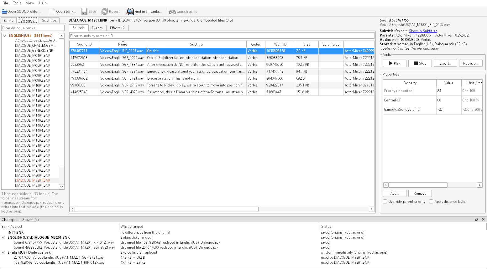

# FAST — Full Alien isolation Sound Tool

*Deep Wwise bank editing for* Alien: Isolation*, works alongside [OpenCAGE](https://github.com/MattFiler/OpenCAGE).* By **DougTheSquirrel**.

**[Download the latest version](https://github.com/mc68k/FAST-Release/releases/latest)** (Windows 10 or 11, 64-bit)

FAST opens *Alien: Isolation*'s sound banks so you can listen to every sound and voice line, replace them with your own, change subtitles and tune the game's reverbs, without unpacking anything by hand. It writes the game's own formats directly, keeps the original of every file it changes, and can put everything back.

> **FAST is alpha software.** Back up your game's `DATA\SOUND` and `DATA\TEXT` folders before editing.

## Features

- **Listen and export.** Every sound and voice line in the game, with its original file name, subtitle, size and volume. Export as WAV.
- **Replace sounds and voice lines** with your own WAV, OGG, FLAC or MP3. FAST converts them to the game's Wwise Vorbis format, keeps subtitle timing, and can trim, fade and match the original's loudness. Drag a file onto the window to replace.
- **Subtitles.** Read every subtitle in all nine languages, search lines by what's said, give a line another subtitle or your own text, and move lines between missions with their subtitles.
- **Reverbs and effects.** Change the game's room reverbs with plain sliders (length, room size, how much reverb), edit EQ, delay, compressor and the radio distortion, or give a room a recorded convolution reverb, designed in FAST or from your own impulse response.
- **Find anything.** Search every bank for a sound or event by name or ID, and dig up audio the game never uses.
- **DLC maps.** The DLC maps' sound packages are listed and editable like any other bank.
- **Undo anything.** The Changes panel lists every change down to the setting, and restores the originals, one change or all of them.
- **Guided tours.** Help → Show me how walks you through your first changes on your own game files, each with an Undo at the end.
- **Finds the game** in Steam, Epic Games, GOG and the Microsoft Store, and launches it through its store to try your changes.
- **Command line.** `fast-cli.exe` does most of the same from a command prompt, for scripting and batch work.

## Getting started

1. Download the zip from the [latest release](https://github.com/mc68k/FAST-Release/releases/latest) and unzip it anywhere, for example `C:\Tools\FAST`. There's nothing to install. Keep the files together: FAST.exe needs the DLLs and folders next to it.
2. Start `FAST.exe`. It finds the game and offers to open its sound folder.
3. Take a tour (FAST offers them; they're also in Help → Show me how), or open `FAST-guide.html`, the illustrated guide (Help → User guide, or F1 over anything in FAST).

## Sound names

FAST can show the game's sounds by their original names (`Voices\English(US)\A1_M0101_SAM_2554.wav` instead of a number). Those names were collected by **Matt Filer** for his [Alien: Isolation Audio Extractor](https://github.com/MattFiler/Alien-Isolation-Audio-Extractor); FAST asks before downloading them from his repository.

## Updates and privacy

Once a week FAST checks this page for a newer version and asks before installing it (Help → Check for updates once a week turns this off). It sends nothing about you, your PC or your files: it only asks GitHub which version is the latest, the way a web browser opens a page. Updates are checked against their published checksums before anything is replaced.

## Reporting problems

Please [open an issue](https://github.com/mc68k/FAST-Release/issues/new/choose). If FAST closed unexpectedly, it saved a crash report and offers it the next time it starts; attaching it helps a lot (your user name is already taken out of it).

## Credits and licenses

FAST is made by **DougTheSquirrel**. Thanks to Matt Filer for OpenCAGE and the sound names.

FAST uses [Qt](https://www.qt.io/) (LGPL v3), [vgmstream](https://github.com/vgmstream/vgmstream), [libogg and libvorbis](https://xiph.org/), [dr_flac and dr_mp3](https://github.com/mackron/dr_libs), and the GCC and MinGW-w64 runtime libraries. Their licenses are in the `licenses` folder of every download.

FAST is a fan-made tool and is not affiliated with or endorsed by the makers of *Alien: Isolation* or Wwise. *Alien: Isolation* and Wwise are the property of their respective owners.
